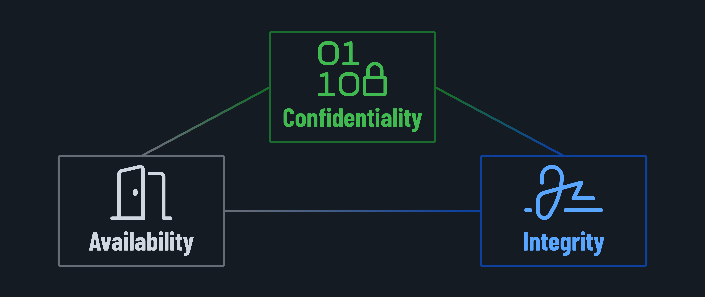
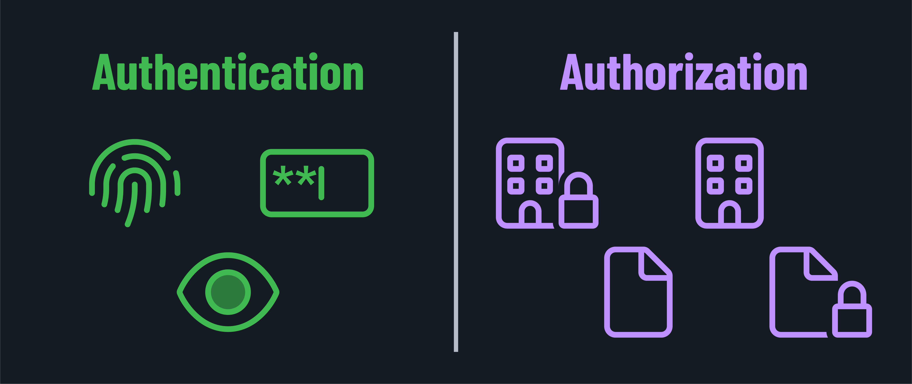
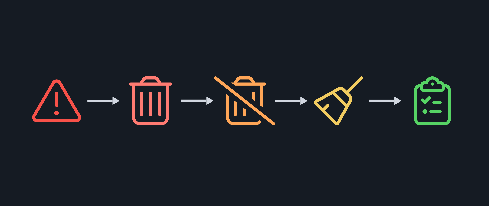

<h1>
  Intro to Cybersecurity
  Understanding Security Fundamentals
</h1>

**Learning objective:** By the end of this lesson, students will be able to explain the fundamental building blocks of cybersecurity, including the CIA triad and the relationship between assets, threats, vulnerabilities, and risks.

## Welcome to cybersecurity!

Ready to learn how to protect yourself and others in the digital world? Let's dive into the foundations of cybersecurity! Don't worry; we'll keep it fun and practical.

## What is cybersecurity?

Think of cybersecurity as protecting a world-class art museum for your digital life. Just like a museum has:

- ID badges and security passes (authentication)
- Security cameras and guards (monitoring)
- Alarm systems (alerting)
- Visitor logs (identity and access management or IAM)
- Art restoration experts (recovery procedures)
- Insurance policies (risk management)

You need similar protections for your digital world!

Museums, like your digital life, have different valuables that need varying types of protection.

Some pieces, like your public social media, need to be viewed by everyone. Others are for select visitors only, like your personal files. Finally, select items require maximum security (like your banking information).

Just like a museum can't rely on only locks, your digital security is best protected by utilizing multiple layers working together!

## The CIA Triad

Confidentiality, integrity, and availability, or the CIA triad, is the core concept of information security. These three concepts and the places they intersect provide a framework for organizations to build sensible policies around communication, data, and infrastructure.

Let's dive into each:

1. Confidentiality (keeping secrets)

   - **What it is**: Keeping private stuff private.
   - **Real-life example**: Your mailbox with a key.
   - **Digital example**: Encrypted messages that only trusted parties are able to decrypt.
   - **Why it matters**: Prevents unauthorized parties from snooping.

2. Integrity (ensuring truthfulness)

   - **What it is**: Making sure nothing has been altered unintentionally.
   - **Real-life example**: Tamper evident seals on medicine bottles.
   - **Digital example**: Digital signatures on emails.
   - **Why it matters**: You know your data is true and correct.

3. Availability (access protection)

   - **What it is**: Having your things available when you need them.
   - **Real-life example**: Having spare car keys.
   - **Digital example**: Data backups.
   - **Why it matters**: You can only be productive if you always have access to your data when needed.

## Key terms

Let's cover some key terms. We'll start with a lightning round and then dive into some deeper topics.

1. *Assets*: What you're protecting. Examples include personal info, photos, emails, banking details, and passwords.
2. *Vulnerabilities*: These are where bad actors might get in. Examples include outdated software, weak passwords, unpatched systems, and unlocked devices.
3. *Threats*: Accounts for what could go wrong. Examples include hackers, scammers, natural disasters, and human error.
4. *Risks*: An assessment of what could go wrong and the impact that they will have if they do.

   In other words, if your *assets* have *vulnerabilities* that a *threat* can act on, you are at *risk*.

   In the real world, this might look something like an unlocked door (vulnerability) at the museum that is used by robbers (bad actors) to steal (threat) artifacts (assets) from the museum.

   The risk level may depend upon where the museum is located, the value of the artifacts, and the other safeguards already in place.

> 💡 Connect what we've discussed so far with the below terms as we go!

### Authentication and authorization

These terms are often bundled together, but they cover different aspects of security.

- **Authentication**: Deals with verifying a user's or device's identity to ensure they are who they say they are. Common methods include passwords, biometrics, MFA (multi-factor authentication), and security tokens like passkeys.
- **Authorization**: Determines what a user or device can access after they've been authenticated. Authorization is often managed through RBAC (role-based access control), where permissions are assigned based on a person's role within an organization.

In short, authentication is about proving who you are, while authorization is about what you can do once you have proven your identity (or even before you've proven your identity).

### Encryption

Encryption is the process of converting data into a code that unauthorized parties can't be read. There are two main types of encryption:

- **Asymmetric encryption**: Uses two keys, a public key to encrypt data and a private key to decrypt it. The private key must be kept secret, but the public key can be shared with anyone. The keys are mathematically related, but deriving the private key from the public key is infeasible.
- **Symmetric encryption**: Uses the same key to encrypt and decrypt data. Everyone who needs to encrypt or decrypt the data must have the same key, but this key must also be kept secret, making it more challenging to manage. This makes their use less common.

Encryption protects data in transit (like an email message or online shopping) and at rest (like files stored on a hard drive).

Several types of encryption algorithms are used. The most common for symmetric encryption is the AES (Advanced Encryption Standard), notable for being adopted widely by the U.S. government. The most common for asymmetric encryption is RSA (Rivest-Shamir-Adleman). It's notable for being the first algorithm to allow secure communication between two parties without a shared secret. RSA is used in the majority of secure communication on the internet.

### Incident response

When a security breach or cyberattack occurs, responding quickly, effectively, and systematically is necessary. Incident response aims to handle the aftermath of an event in a way that limits damage, reduces recovery time, and minimizes costs (be they material costs or related to the loss of data or even reputation).

By having an incident response plan in place, the right people can be organized and deployed quickly. The most effective plans will even allow them to take mostly predefined actions rather than having to come up with a response while under pressure. This can prevent a situation from spiraling out of control.

#### Key steps in incident response

1. **Detection**: Identify that an incident has occurred.
2. **Containment**: Limit the spread of the incident.
3. **Eradication**: Remove the cause of the incident.
4. **Recovery**: Restore normal operations. Restore any affected systems and ensure no threat remains.
5. **Lessons learned**: Document the incident and the response taken. Think critically about what worked and what didn't. Use this info to refine your response plans and prevent future incidents before they start.
